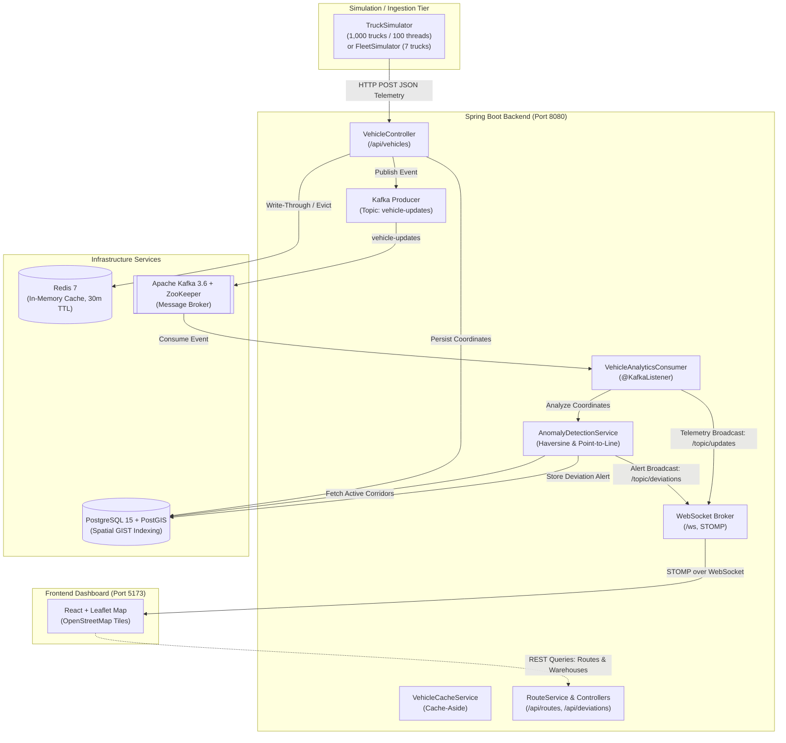

# Fleet Admin: Real-Time Logistics Digital Twin Dashboard

> A high-throughput, event-driven IoT tracking and logistics monitoring platform featuring real-time GPS telemetry ingestion, Redis caching, PostGIS spatial queries, Kafka stream processing, geometric route anomaly detection, and a live React + Leaflet map interface.

---

## 📌 Project Overview & Aim

**Fleet Admin** is a real-time digital twin and fleet management system modeled after regional freight and delivery logistics in South Africa (centered on the Western Cape corridor between Cape Town, Stellenbosch, and Paarl). 

The platform is designed to handle high-frequency IoT location updates from thousands of concurrent delivery vehicles, providing fleet operators with instant situational awareness, proximity search, and automated alerts when vehicles stray off course.

### Core Objectives
* **High-Throughput Ingestion at Scale:** Ingest concurrent telemetry streams from 1,000+ trucks using non-blocking, multi-threaded pipelines without database connection saturation.
* **Sub-Millisecond State Retrieval:** Offload read traffic from the primary database using an in-memory Redis caching tier with a cache-aside strategy.
* **Geospatial Proximity Intelligence:** Use PostgreSQL and PostGIS spatial indexing (GIST, `ST_DWithin`, and KNN `<->`) to calculate which vehicles are near depots, warehouses, or customer delivery locations.
* **Decoupled Asynchronous Processing:** Utilize Apache Kafka message streaming to decouple raw GPS telemetry ingestion from compute-intensive downstream analytics (speed analysis, route progress, and anomaly detection).
* **Mathematical Route Anomaly Detection:** Implement geometric algorithms (Haversine geodesic distance and point-to-line segment orthogonal projection) to detect route deviations exceeding configurable thresholds (200m, 500m, 1,000m) in real time.
* **Live Operations Dashboard:** Stream telemetry and deviation alerts over WebSockets (STOMP protocol) directly to a modern web map interface with animated breadcrumb trails and interactive popups.

---

## 🏛️ System Architecture

The system follows an event-driven, tiered architecture that decouples high-speed data ingestion from persistence, spatial analysis, and browser visualization.



### Telemetry Lifecycle
1. **Telemetry Generation:** `TruckSimulator` concurrently generates realistic GPS movements for 1,000 trucks using Java's `ExecutorService` and posts JSON to `/api/vehicles`.
2. **Ingestion & Caching:** `VehicleController` receives updates, persists state to PostgreSQL, updates Redis cache (`vehicle:<truckId>`), and produces an event to Kafka's `vehicle-updates` topic.
3. **Decoupled Analytics:** `VehicleAnalyticsConsumer` consumes the event asynchronously and delegates calculation to `AnomalyDetectionService`.
4. **Deviation Analysis:** `AnomalyDetectionService` retrieves the truck's active route and waypoints, computes orthogonal distance to each segment, and if deviation exceeds threshold (>200m), creates an alert and broadcasts to `/topic/deviations`.
5. **Live Dashboard Update:** Telemetry is broadcasted to `/topic/updates`, where the React + Leaflet frontend renders the truck marker and polyline history in real time.

---

## 🛠️ Technology Stack

| Layer | Technology | Details / Purpose |
| :--- | :--- | :--- |
| **Backend Framework** | Spring Boot 4.x / Java 17 | Core application framework, REST APIs, dependency injection |
| **Persistence & Spatial** | Spring Data JPA, Hibernate, JTS Core | Object-relational mapping, geometry types (`Point`) |
| **Spatial Database** | PostgreSQL 15 + PostGIS | Geospatial coordinates, GIST spatial index, `ST_DWithin`, KNN `<->` |
| **In-Memory Cache** | Redis 7 + Spring Data Redis | High-speed cache-aside layer for vehicle lookups (`vehicle:<id>`) |
| **Event Streaming** | Apache Kafka 3.6 + Confluent ZooKeeper | Scalable message broker for decoupling ingestion from analytics |
| **Real-Time Push** | Spring WebSocket + STOMP Messaging | WebSocket broker (`/ws`) publishing to `/topic/updates` & `/topic/deviations` |
| **Frontend UI** | React 18, Vite, Leaflet, `react-leaflet` | Interactive map dashboard, vehicle pins, polyline breadcrumb trails |
| **WebSocket Client** | `@stomp/stompjs` | Subscribes to real-time telemetry streams from browser |
| **Orchestration** | Docker, Docker Compose, Batch & PowerShell | Containerized infrastructure and automated startup workflows |

---

## 🚀 Key Features Implemented

### 1. Multi-Threaded Fleet Simulator
* Concurrently manages 1,000 trucks over a thread pool of 100 threads (`ExecutorService`).
* Generates independent GPS drift, turns, and jitter centered in Cape Town (`-33.9249, 18.4241`).
* Built-in graceful shutdown via runtime hooks.

### 2. Redis Caching Tier (Cache-Aside Pattern)
* Read-through caching on `GET /api/vehicles/{truckId}`: checks Redis first; falls back to PostgreSQL on cache miss.
* Write-through caching on vehicle update with a 30-minute Time-To-Live (TTL).
* Structured JSON serialization via Jackson serializers.

### 3. PostGIS Spatial Intelligence
* Automated schema configuration adding `geometry(Point, 4326)` with GIST spatial indexes.
* Proximity search: `GET /api/locations/{id}/vehicles-nearby?radius=5000` finds all trucks within $X$ meters of any warehouse.
* Nearest vehicle search: `GET /api/locations/{id}/nearest-vehicle` leverages PostGIS `<->` operator for instant nearest-asset dispatch.

### 4. Vector Geometry Route Anomaly Detection
* **Haversine Geodesic Distance:** Computes exact spherical distance over the Earth's surface ($R = 6,371,000\text{ m}$).
* **Point-to-Line Segment Orthogonal Projection:** Projects vehicle coordinates onto corridor line segments between consecutive waypoints, clamping the parametric scalar $t \in [0, 1]$ to detect the closest distance to the intended path.
* **Tiered Severity Classification:**
  * **Low:** $> 200\text{ m}$ deviation
  * **Medium:** $> 500\text{ m}$ deviation
  * **High:** $> 1,000\text{ m}$ deviation
* **Alert Lifecycle:** Complete workflow to track alerts (`NEW` $\rightarrow$ `ACKNOWLEDGED` $\rightarrow$ `RESOLVED`).

### 5. Automated Data Seeding
* `DataInitializer` seeds 10 regional logistics hubs on first run:
  * Cape Town Central, Stellenbosch Depot, Paarl DC, George Logistics Hub, Bellville Depot, Durban North, Johannesburg Central, Pretoria Depot, Port Elizabeth Hub, and Bloemfontein.
* Seeds 2 active multi-waypoint routes (`ROUTE-001` Cape Town to Stellenbosch, `ROUTE-002` Cape Town to Paarl) with expected arrival times.

---

## 📡 API & Messaging Reference

### REST Endpoints

| Category | Method | Endpoint | Description |
| :--- | :--- | :--- | :--- |
| **Vehicles** | `GET` | `/api/vehicles/ping` | Health check probe |
| | `GET` | `/api/vehicles` | List all tracked vehicles |
| | `GET` | `/api/vehicles/{truckId}` | Get single vehicle (checks Redis cache first) |
| | `POST` | `/api/vehicles` | Ingest vehicle location update |
| **Locations** | `GET` | `/api/locations` | List all logistics hubs/warehouses |
| | `POST` | `/api/locations` | Register a new location/hub |
| | `GET` | `/api/locations/{id}/vehicles-nearby` | Find vehicles within radius (default: 5000m) |
| | `GET` | `/api/locations/{id}/nearest-vehicle` | Find closest vehicle to location |
| **Routes** | `GET` | `/api/routes` | List all planned, active, and completed routes |
| | `GET` | `/api/routes/{id}` | Get route details |
| | `GET` | `/api/routes/active/{truckId}` | Get active route assigned to a truck |
| | `GET` | `/api/routes/{id}/waypoints` | Get ordered waypoints for a route |
| | `POST` | `/api/routes` | Create route with waypoints |
| | `PUT` | `/api/routes/{id}/activate` | Set route status to `ACTIVE` |
| | `PUT` | `/api/routes/{id}/complete` | Set route status to `COMPLETED` |
| **Deviations** | `GET` | `/api/deviations` | List all recorded deviations |
| | `GET` | `/api/deviations/active` | List unresolved/new deviations |
| | `GET` | `/api/deviations/truck/{truckId}` | List deviations for a specific truck |
| | `PUT` | `/api/deviations/{id}/acknowledge`| Acknowledge an alert |
| | `PUT` | `/api/deviations/{id}/resolve` | Mark an alert as resolved |

### WebSocket Broker

* **Connection Endpoint:** `ws://localhost:8080/ws`
* **Subscribed Topics:**
  * `/topic/updates` — Broadcasts real-time vehicle coordinates (`Vehicle` object).
  * `/topic/deviations` — Broadcasts route anomaly alerts (`RouteDeviation` object).

---

## 📂 Project Structure

```
Fleet_admin/
├── docker-compose.yml              # PostgreSQL, PostGIS, Kafka, ZooKeeper, Redis
├── start-fleet.bat                 # One-click startup script (Docker + backend + frontend)
├── stop-fleet.bat                  # Service teardown script
├── MANUAL_SETUP.md                 # Detailed manual installation guide (non-Docker)
│
├── fleet-backend/                  # Spring Boot 4.x / Java 17 application
│   ├── pom.xml                     # Maven dependencies (JPA, PostGIS, Kafka, Redis, WS)
│   ├── setup_postgis.sql           # PostGIS triggers and spatial index setup
│   ├── run_postgis.ps1             # PowerShell PostGIS setup script
│   └── src/main/java/com/logistics/fleet_backend/
│       ├── FleetBackendApplication.java # Spring Boot entry point
│       ├── FleetSimulator.java          # 7-truck lightweight simulator
│       ├── TruckSimulator.java          # 1,000-truck / 100-thread load simulator
│       ├── config/                      # Kafka, Redis, WebSocket, Anomaly, Seed config
│       ├── consumer/                    # Kafka listeners (VehicleAnalyticsConsumer)
│       ├── controller/                  # REST controllers (Vehicle, Route, Location, Deviation)
│       ├── model/                       # JPA entities (Vehicle, Location, Route, Waypoint, Deviation)
│       ├── repository/                  # Spring Data & PostGIS spatial repositories
│       └── service/                     # Business logic (AnomalyDetection, Route, Cache)
│
└── fleet-frontend/                 # React 18 + Vite frontend
    ├── package.json                # Dependencies (@stomp/stompjs, leaflet, react-leaflet)
    ├── vite.config.js              # Vite bundler configuration
    └── src/
        ├── main.jsx                # Application root mounting
        ├── App.jsx                 # Main layout component
        └── components/
            └── FleetMap.jsx        # Real-time Leaflet map with WebSocket listener
```

---

## ⚡ Getting Started

### Option 1: Quick Start with Docker (Recommended)

1. Make sure **Docker Desktop** is installed and running.
2. Run the quick start batch script:
   ```cmd
   start-fleet.bat
   ```
   *This starts the infrastructure containers (PostgreSQL, Kafka, Redis), launches the Spring Boot backend, and starts the Vite frontend dev server.*
3. Access the services:
   * **Frontend Map Dashboard:** `http://localhost:5173`
   * **Backend REST API:** `http://localhost:8080/api/vehicles/ping`
   * **Kafka Broker:** `localhost:9092`
   * **Redis Server:** `localhost:6379`
   * **PostgreSQL:** `localhost:5432` (database: `fleet_logistics`, user: `postgres`)

4. Stop all services when finished:
   ```cmd
   stop-fleet.bat
   ```

---

### Option 2: Manual / Step-by-Step Execution

#### 1. Start Infrastructure Services
```bash
docker-compose up -d
```
*(Alternatively, consult [`MANUAL_SETUP.md`](MANUAL_SETUP.md) to run PostgreSQL, Kafka, and Redis natively on Windows).*

#### 2. Start the Backend
```bash
cd fleet-backend
.\mvnw.cmd spring-boot:run
```

#### 3. Start the Frontend
```bash
cd fleet-frontend
npm install
npm run dev
```
Open [http://localhost:5173](http://localhost:5173) in your browser.

#### 4. Run the Truck Simulator
In a separate terminal, trigger the telemetry generator:
```bash
cd fleet-backend
# Run lightweight simulator (7 trucks):
.\mvnw.cmd exec:java -Dexec.mainClass="com.logistics.fleet_backend.FleetSimulator"

# OR run high-concurrency load simulator (1,000 trucks):
.\mvnw.cmd exec:java -Dexec.mainClass="com.logistics.fleet_backend.TruckSimulator"
```
Watch the vehicles appear and draw real-time paths across the Cape Town map!
